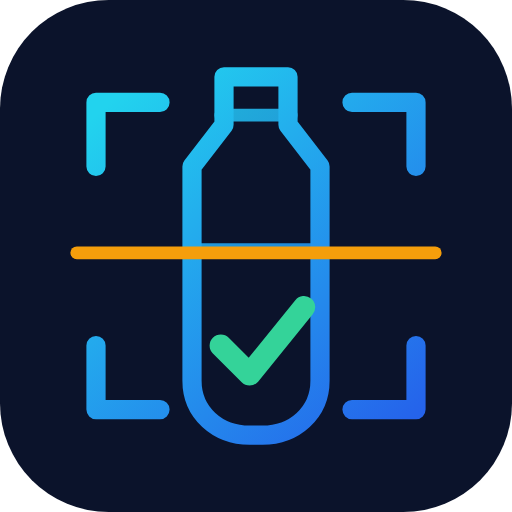
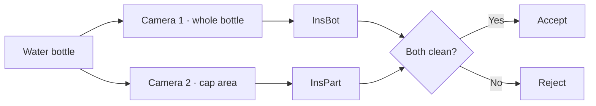

<p align="center">
  
</p>

<h1 align="center">InsComb</h1>

<p align="center"><strong>Dual-camera edge AI for water-bottle quality control.</strong></p>

<p align="center">
  
  
  
  
</p>

<p align="center">
  <a href="#system-at-a-glance">Overview</a> ·
  <a href="#results">Results</a> ·
  <a href="#getting-started">Getting started</a> ·
  <a href="report/PFE_report.pdf">Full report</a>
</p>

InsComb is a computer-vision inspection system for bottled-water production.
Two InceptionV3 classifiers inspect complementary camera views—the complete
bottle and its cap area—and accept a bottle only when both models classify it
as clean. Training uses PyTorch; deployment uses ONNX Runtime with TensorRT or
CUDA acceleration on an NVIDIA Jetson Nano.

**Authors:** Ahmed Taibeche & Oussama Chams Eddine Fezzai

This final-year engineering project (*Mémoire de fin d'études*, Diplôme
d'Ingénieur d'État in Automatic Control and Industrial Computing) was completed
at École Nationale Supérieure de Technologie, Algiers, supervised by Mme Karima
Rebai and defended on 4 July 2023 (academic year 2022–2023).

The [full project report](report/PFE_report.pdf) is in French. Chapter 3 covers
the models and results; chapter 4 covers the industrial prototype.

> **Note:** this repository is not the complete project. It only contains the open-source part: the data preparation, GAN augmentation, training, export, evaluation and inference code. The following parts are not included:
> - the final weights of the trained models (InsBot and InsPart)
> - the dataset
> - the web dashboard (the Node-RED supervision page with the inspection statistics)
> - the Jetson Nano part (the application deployed on the prototype and its communication with the PLC)
> - the production version of the inspection system (with the PLC and HMI of the inspection line, described in chapter 4 of the report)

## System at a glance

| Final configuration | Test accuracy | Edge throughput | Deployment |
|---|---:|---:|---|
| InsBot + InsPart | **94.5%** on 1,600 images | **9 FPS** with both models | Jetson Nano · ONNX Runtime · TensorRT/CUDA |



The two-view design targets the cap defects that the whole-bottle model found
hardest. It keeps the decision conservative: one defective prediction is enough
to reject the bottle.

## Introduction
In today's manufacturing industry, ensuring product safety is paramount, particularly in the production of bottled water. Visual inspection plays a crucial role in maintaining quality standards and safeguarding consumer health. This project focuses on the development of a robust system for visual inspection in water bottle production, leveraging deep learning techniques.

## Approach
Our approach primarily revolves around utilizing pre-trained deep learning models and employing transfer learning. Specifically, we concentrate on well-established models renowned for their performance, such as ResNet18, ResNet50, and InceptionV3. These models, having been trained on extensive datasets, offer a wealth of pre-existing knowledge which we harness through transfer learning. The objective is to retrain these networks to proficiently recognize images of both defect-free (Propre) and defective water bottles.

The final system, **InsComb**, runs two InceptionV3 models in parallel on the Jetson Nano, each with its own camera: **InsBot** inspects the whole bottle and **InsPart** focuses on the top of the bottle, where the whole-bottle model missed the most defects (only 57% of the badly closed caps were detected). A bottle is accepted as clean (Propre) only when both models classify it as clean. InsComb reaches an accuracy of **94.5%** on the test set.

## Results
Test results reported in chapter 3 of the report (the models were tested on 480 images, InsPart on 200 and InsComb on 1600):

| Model | Accuracy | Recall | Precision | F1 score |
|---|---|---|---|---|
| ResNet18 | 83.05% | 83.3% | 80.1% | 81.6% |
| ResNet50 | 92.35% | 88.7% | 97% | 92.66% |
| InceptionV3 (InsBot, whole bottle) | 91% | 92.1% | 94% | 93% |
| InceptionV3 with 4 extra dense layers | 87% | 87.7% | 86% | 86.8% |
| CNN trained from scratch | 84.5% | 86.3% | 82% | 84% |
| InceptionV3 (InsPart, top of the bottle) | 97.5% | 97.02% | 98% | 97.5% |
| **InsComb (InsBot + InsPart)** | **94.5%** | **94%** | **95%** | **94.5%** |

The best training setup was the Adam optimizer with an initial learning rate of 0.0001 for 50 epochs, which are the defaults of `train.py`.

Real-time performance in frames per second (chapter 4):

| | Intel Core i5-6300U (CPU) | NVIDIA RTX 3050 | Jetson Nano |
|---|---|---|---|
| One model | 13 FPS | 61 FPS | 10 FPS |
| Two models (InsComb) | 10 FPS | 61 FPS | 9 FPS |

## Implementation Details
- **Framework**: PyTorch for training, ONNX Runtime (with TensorRT / CUDA on the Jetson Nano) for inference.
- **Target Platform**: Edge application, specifically designed for deployment on the Jetson Nano developer kit for inference.
- **Data Collection and Augmentation**: We built our own dataset (2400 photos per class, with cap, fill level, foreign object and deformation defects) and augmented it with a custom script (`data_augmentation.py`): rotation, stretching, contrast, luminosity, color filtering, elastic blur, cutout, noise and zoom.
- **Data Preprocessing**: The images are resized and split into train / validation / test sets (`data_processing_split.py`), keeping all the augmented versions of a photo in the same set so that the validation and test sets only contain unseen bottles. Normalization is applied by the training transforms.
- **GAN Augmentation**: A DCGAN (`src/gan/`) can be trained on the training photos of each class to generate new synthetic bottle images for the training set. Spectral normalization, a minibatch standard deviation layer and differentiable augmentation (DiffAugment) help it train stably and produce varied images from a few thousand photos.
- **Model Training**: We fine-tuned the selected pre-trained architectures on our dataset with a custom script (`train.py`), comparing the Adam and SGD optimizers, learning rates, weight decay and dropout.
- **Model Export**: After training, we exported the trained models to the ONNX format (`export_onnx.py`). This format offers compatibility and efficiency for deployment on edge devices like the Jetson Nano, facilitating seamless integration into production environments.
- **Inference**: A dedicated script (`inference.py`) runs one model, or the two InsComb models, on live camera feeds in real time, allowing rapid and accurate identification of defective water bottles during production.

## Project Structure
```
.
├── report/
│   └── PFE_report.pdf          # final project report (French)
├── src/
│   ├── data/
│   │   ├── data_augmentation.py     # generate augmented images
│   │   └── data_processing_split.py # resize and split into train/val/test
│   ├── training/
│   │   ├── train.py                 # transfer-learning training loop
│   │   └── reshape.py               # create a model and replace its classifier head
│   ├── gan/
│   │   ├── dcgan.py                 # DCGAN generator and discriminator
│   │   ├── diffaugment.py           # differentiable augmentation for small datasets
│   │   ├── train_gan.py             # train a GAN on the training photos of one class
│   │   └── generate.py              # generate synthetic training images
│   ├── export/
│   │   ├── export_onnx.py           # PyTorch checkpoint -> ONNX
│   │   └── evaluate_onnx.py         # accuracy, precision/recall/F1 and confusion matrix on a test set
│   └── inference/
│       ├── onnx_classifier.py       # ONNX Runtime model with the training preprocessing
│       └── inference.py             # real-time camera inference (one model or InsComb)
└── requirements.txt
```

## Getting Started

### Installation
```bash
python -m venv .venv
source .venv/bin/activate
pip install -r requirements.txt
```
On the Jetson Nano, evaluation and inference only need `numpy`, `Pillow`, `opencv-python` and the `onnxruntime-gpu` wheel from NVIDIA's Jetson Zoo: PyTorch is only used for training and export.

### Dataset and models
The dataset and the trained models are confidential and are not included in this repository (`raw/`, `augmented/`, `data/` and `models/` are ignored by git). To use the scripts with your own photos, they expect one folder per class:
```
raw/                  augmented/            data/bottles/
├── Defective/   ->   ├── Defective/   ->   ├── train/{Defective,Propre}/
└── Propre/           └── Propre/           ├── val/{Defective,Propre}/
                                            └── test/{Defective,Propre}/
```

### Usage
All scripts are run as modules from the repository root, `--help` lists all their options.

1. **Augment** the photos of each class (`--include-original` keeps the original photos in the dataset):
   ```bash
   python -m src.data.data_augmentation raw/Propre augmented/Propre --include-original
   python -m src.data.data_augmentation raw/Defective augmented/Defective --include-original
   ```
   Add `--augmentations rotate stretch contrast blur cutout noise` to use the augmentations of the report.
2. **Resize and split** each class into `train/`, `val/` and `test/` (the split is reproducible with `--seed`):
   ```bash
   python -m src.data.data_processing_split augmented/Propre data/bottles --class-name Propre --size 299
   python -m src.data.data_processing_split augmented/Defective data/bottles --class-name Defective --size 299
   ```
3. **Generate synthetic images with a GAN** (optional): train a DCGAN on the training photos of each class, then add generated images to its training folder:
   ```bash
   python -m src.gan.train_gan data/bottles/train/Propre --model-dir models/gan/Propre
   python -m src.gan.generate models/gan/Propre/gan_checkpoint.pth.tar data/bottles/train/Propre --count 1000 --size 299
   ```
   Same for `Defective`. Check the samples saved in `models/gan/<class>/samples/` before using the generated images, especially for `Defective`: small defects (e.g. a small foreign object) can disappear at 64x64, which would add mislabeled images. The GAN only learns from the original photos of the training split (augmented copies are skipped unless `--include-augmented`), and its images must never go to `val/` or `test/`: these sets must stay real, unseen photos. `--image-size 128` gives more detail but needs a GPU and more epochs.
4. **Train** (Inception models use 299x299 images, the others 224x224):
   ```bash
   python -m src.training.train data/bottles --arch inception_v3 --model-dir models/inception_v3
   tensorboard --logdir models/inception_v3/tensorboard
   ```
   Other options: `--optimizer sgd`, `--lr`, `--epochs`, `--dropout 0.5`, `--freeze-backbone` (only train the new classification layers) and lighter architectures for the Jetson Nano such as `--arch mobilenet_v3_large` or `efficientnet_b0`.
5. **Export** the best checkpoint to ONNX (single-file model with opset 13 for TensorRT 8 on the Jetson Nano, checked against PyTorch):
   ```bash
   python -m src.export.export_onnx --model-dir models/inception_v3
   ```
6. **Evaluate** the ONNX model on the test set:
   ```bash
   python -m src.export.evaluate_onnx models/inception_v3/inception_v3.onnx data/bottles/test --show-errors
   ```
7. **Run** real-time inference from a camera (press `q` to quit):
   ```bash
   python -m src.inference.inference models/inception_v3/inception_v3.onnx --source 0
   ```
   The InsComb system adds the top-of-the-bottle model and its camera:
   ```bash
   python -m src.inference.inference models/insbot/inception_v3.onnx --source 0 \
       --part-model models/inspart/inception_v3.onnx --part-source 1
   ```
   `--source` also accepts a video file or a GStreamer pipeline, e.g. for a CSI camera on the Jetson Nano:
   `'nvarguscamerasrc ! video/x-raw(memory:NVMM), width=1280, height=720 ! nvvidconv ! video/x-raw, format=BGRx ! videoconvert ! video/x-raw, format=BGR ! appsink'`.
   Use `--no-display` to only print the predictions, e.g. over SSH.

## Conclusion
Our project presents a comprehensive solution for visual inspection in water bottle production, leveraging the power of deep learning and edge computing. By integrating advanced techniques and leveraging pre-trained models, we have demonstrated significant improvements in accuracy and efficiency. We believe that our system holds great potential for improving quality control processes within the manufacturing industry, thereby enhancing product safety and consumer satisfaction.

## Brand assets

- [SVG icon](assets/inspection-mark.svg) — editable, accessible vector source.
- [Transparent PNG](assets/inspection-mark.png) — 512 × 512 pixels for
  presentations, profiles and repository artwork.

## Acknowledgements
- Our supervisor Mme Karima Rebai and the jury members of ENST Algiers.
- The training, ONNX export and model reshape scripts are adapted from the `pytorch-classification` tools of NVIDIA's [jetson-inference](https://github.com/dusty-nv/jetson-inference).

**Keywords:** AI, deep learning, transfer learning, machine learning, computer vision, edge AI
